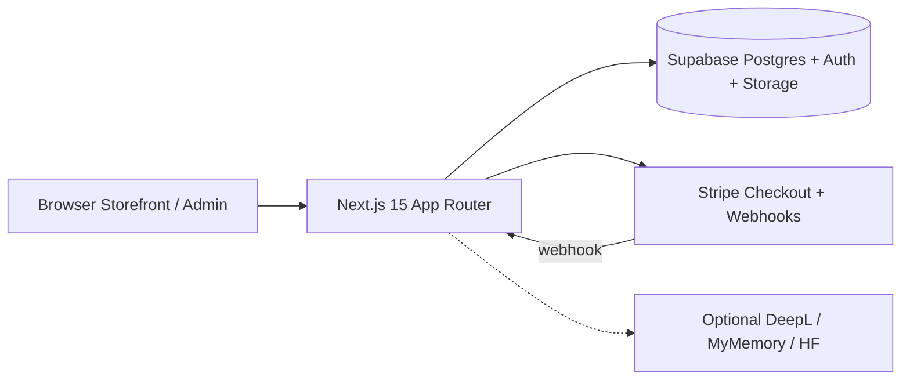
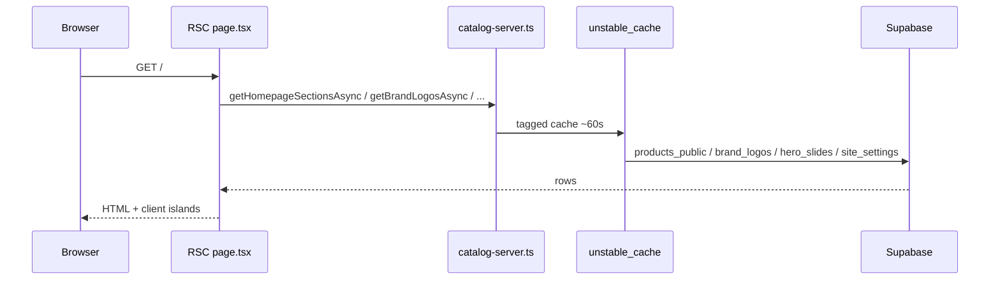
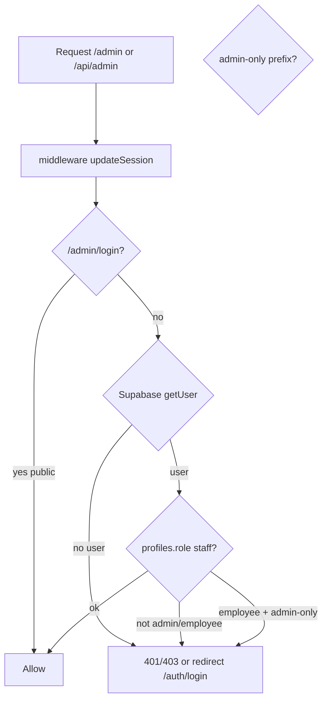
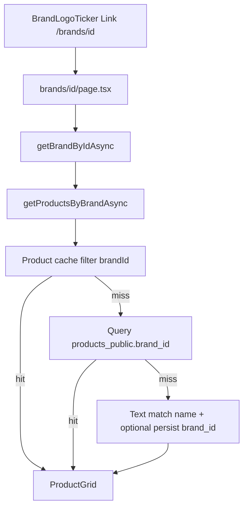
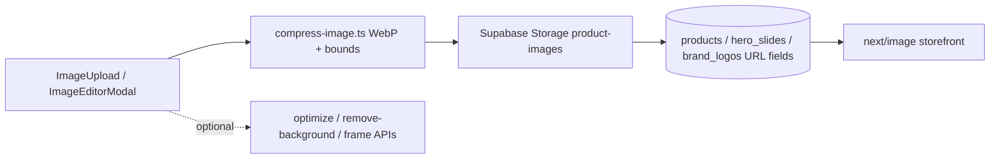
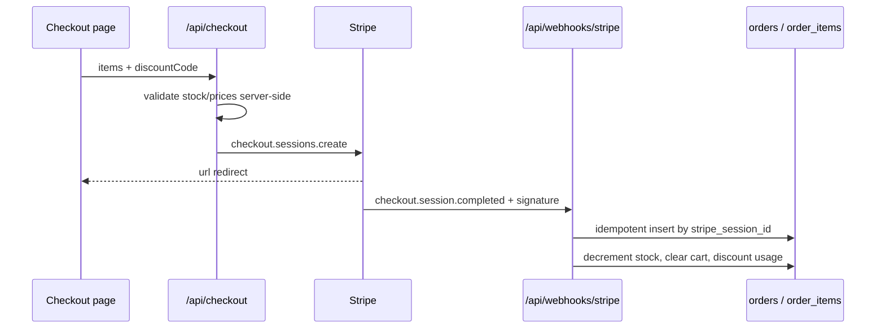

# Architecture

Evidence: **Code** unless marked otherwise. Diagrams reflect inspected modules.

## 1. High-level system



## 2. Request flow (storefront catalog)



## 3. AuthZ flow (admin)



Additional checks: `admin/(dashboard)/layout.tsx`, `requireStaff` / `requireAdmin` in route handlers (`src/lib/admin-server.ts`).

## 4. Brand / product lookup



Files: `BrandLogoTicker.tsx`, `catalog-server.ts` (`getProductsByBrandAsync`).

## 5. Image upload & processing



## 6. Stripe checkout & webhook



## 7. Admin sensitive data path

```mermaid
flowchart LR
  AdminUI[Admin UI]
  API[/api/admin/*]
  Auth[requireStaff / requireAdmin]
  Client[staffDataClient or createServiceClient]
  DB[(Postgres)]

  AdminUI --> API --> Auth --> Client --> DB
```

**Note (Code):** When `SUPABASE_SERVICE_ROLE_KEY` is set, many admin writes use the service role and therefore **bypass RLS**. Authorization then rests entirely on the require* checks. Production policy effectiveness: **Unknown**.

## 8. Major module map

| Module | Path | Role |
|---|---|---|
| Catalog | `src/lib/catalog-server.ts` | Server reads + cache |
| Sort | `src/lib/locale-sort.ts` | Arabic alpha sort |
| Homepage sections | `src/lib/homepage-sections.ts` | Section normalize/dedupe |
| Layout builder | `src/lib/layout-builder.ts` | CSS variables document |
| Admin auth | `src/lib/admin-server.ts` | Staff/admin gates |
| Middleware | `src/middleware.ts` + `supabase/middleware.ts` | Session + admin gate |
| Cart | `src/context/CartContext.tsx` | Guest/auth cart |
| Wishlist | `src/context/WishlistContext.tsx` | Guest/auth wishlist |
| Image pipeline | `src/lib/compress-image.ts`, `image-editor/*` | Upload/edit |
| Stripe | `src/lib/stripe.ts`, `api/checkout`, `api/webhooks/stripe` | Payments |
| i18n shop | `src/lib/shop-i18n.ts`, `ShopLocale.tsx` | AR/DE strings |
| i18n admin | `src/lib/admin-i18n.ts` | AR/DE admin |

## Unknown / unverified connections

- External CDN for `@imgly` ONNX models at runtime — Inferred from comments in `next.config.ts`  
- Exact production Supabase project schema parity with `supabase/migrations` — Unknown  
- Email delivery for auth magic links — Supabase-managed (Inferred)