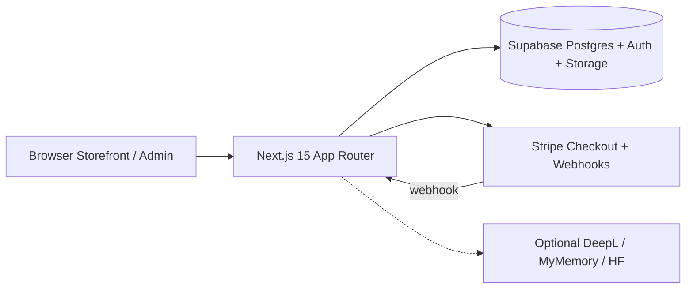
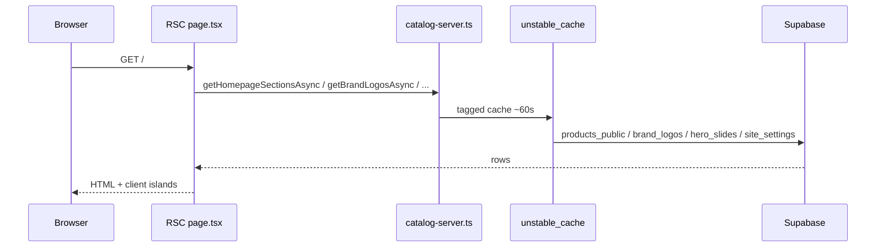
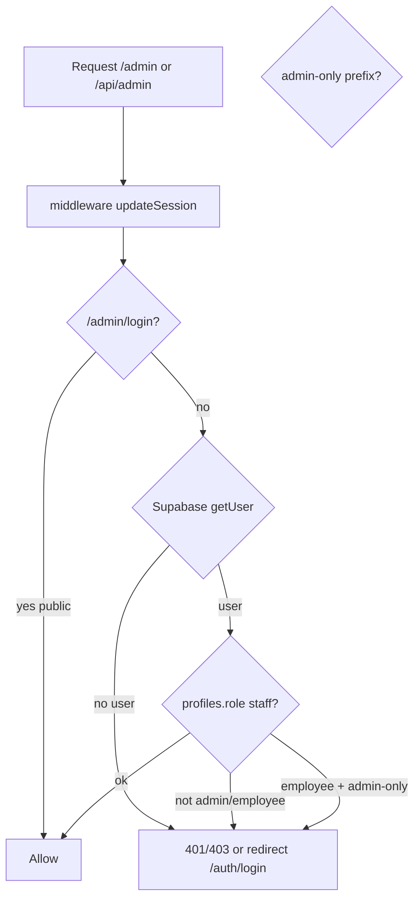
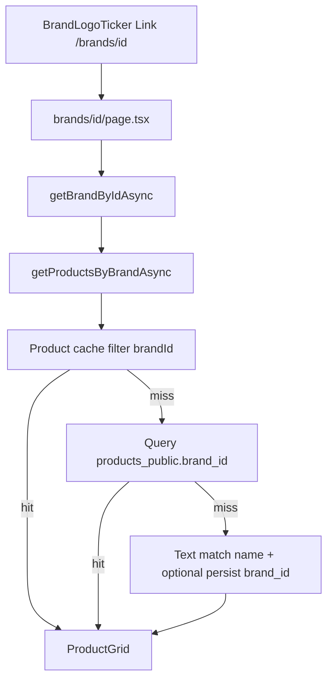
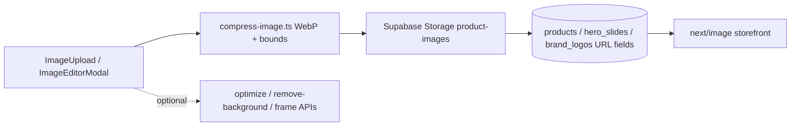
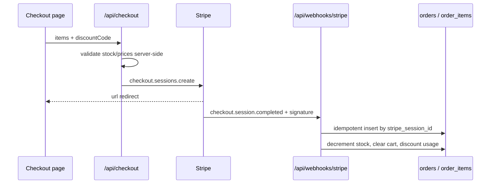

# jmle-shop — Complete Technical Audit

**Audit date:** 2026-10-16 (documentation-only pass)  
**Branch:** `cursor/full-audit-docs-84bd`  
**Method:** Source-code inspection + lockfile versions + safe local HTTP timings where noted.  
**Not performed:** Production DB inspection, dependency upgrades, migrations, deployments, destructive tests.

**Application behavior was not changed by this audit.**

## Evidence legend

| Tag | Meaning |
|---|---|
| **Code** | Confirmed by reading source |
| **Lockfile** | Version from `package-lock.json` |
| **Test** | Confirmed by running a listed command |
| **Local** | Safe GET against local Next.js |
| **Inferred** | Reasonable inference, not verified |
| **Unknown** | Insufficient access/evidence |

## Table of contents

1. [Project status](#project-status)
2. [Technology stack](#technology-stack)
3. [Architecture](#architecture)
4. [Route map](#route-map)
5. [Feature inventory](#feature-inventory)
6. [UI/UX audit](#uiux-audit)
7. [Assets and media](#assets-and-media)
8. [Security audit](#security-audit)
9. [Database architecture](#database-architecture)
10. [Performance audit](#performance-audit)
11. [Testing and quality](#testing-and-quality)
12. [Accessibility and i18n](#accessibility-and-i18n)
13. [Improvement roadmap](#improvement-roadmap)

---

## Project status

**Last audit:** 2026-10-16 (documentation-only pass)  
**Detailed docs:** this file (sections below)

### What it is

**jmle** is an Arabic-first (RTL) / German bilingual online grocery and specialty-food shop. Customers browse products, brands, and categories; add to cart/wishlist; pay via Stripe. Staff manage catalog, media, homepage layout, and (partially) commerce ops in `/admin`.

### How it is built

| Layer | Choice (verified) |
|---|---|
| App | Next.js **15.5.20** App Router + React **19.2.7** (Lockfile) |
| Language | TypeScript **5.9.3** |
| Styling | Tailwind CSS **3.4.19** + `globals.css` tokens |
| Data/Auth/Storage | Supabase (`@supabase/ssr` 0.5.2, `supabase-js` 2.115.0) |
| Payments | Stripe server SDK **17.7.0**; webhook signature + idempotency (Code) |
| Hosting | Vercel (`jmle-shop.vercel.app` hard-coded production host) (Code) |
| Images | Supabase Storage `product-images` + `next/image` AVIF/WebP |

### Main systems

1. **Storefront RSC** — `src/app/page.tsx` + `catalog-server.ts` (cached catalog).  
2. **Admin** — `/admin/*` gated by middleware + layout + `requireStaff`/`requireAdmin`.  
3. **Commerce** — Cart (guest localStorage / auth `cart_items`) → `/api/checkout` → Stripe → webhook → `orders`.  
4. **Media** — Client WebP compress → Storage → public URLs on products/slides/brands.  
5. **Homepage builder** — Sections + layout CSS vars in `site_settings` JSONB.

### Implementation status (high level)

| Area | Status |
|---|---|
| Catalog browse (products/categories/brands) | Implemented (Code) |
| Search | Implemented (header + `/search` + API) |
| Cart / Checkout / Stripe webhook | Implemented (Code); prod webhook config Unknown |
| Wishlist | Implemented guest + DB |
| Admin products/categories/slides/brands/builder/site/trash | Implemented |
| Admin orders/discounts/users | **Pages+APIs exist but missing from sidebar**; mostly read-only |
| Favicon | **Missing** (Code) |
| Footer shop logo | **Prop discarded** in `SiteFooter.tsx` (Code) |
| Storefront product filters (brand/price facets) | **Not found** on `/products` (Code) |
| Automated e2e / CI | **None** (no `.github`, no `npm test`) |

### Most important confirmed problems

1. Admin commerce pages not linked in `AdminSidebar.tsx`.  
2. Discounts: create/list only — no deactivate/delete API/UI.  
3. Users: no role-update API/UI; employee poorly represented.  
4. Orders: read-only; no status workflow UI.  
5. No favicon asset/configuration.  
6. Footer ignores `logoUrl`.  
7. Local home cold TTFB ~1.5s (Local, 2026-10-15 measurement).  
8. Dashboard fetches full product list for counts.  
9. Service-role DB client after staff auth bypasses RLS (Code — prod impact Unknown).  
10. Upload MIME checks mostly client-side.

### Critical unverified areas

- Production RLS policies actually applied  
- Production Stripe webhook endpoint + secrets  
- Deployed schema vs multiple repo SQL files  
- Real Core Web Vitals / Lighthouse on production  
- Visual QA of every admin/storefront page on devices  

### Recommended next steps

See [Improvement roadmap](#improvement-roadmap). Suggested first controlled PRs: sidebar links → discount lifecycle → user roles → favicon/footer logo → dashboard counts API → homepage query slim.

### Evidence sources

- Lockfile dependency versions  
- Source under `src/`, `supabase/`, `next.config.ts`  
- Safe unit tests: 17/17 passed for homepage-sections, locale-sort, layout-builder, shipping (`tsx --test`, 2026-10-16)  
- Prior local HTTP timings documented in [Performance audit](#performance-audit)

---

## Technology stack

Evidence: **Lockfile** = `package-lock.json`; **Code** = import/usage search under `src/`.

### Runtime & app framework

| Technology | Declared | Installed (lockfile) | Usage |
|---|---|---|---|
| Node.js | no `engines` field | Host: v22.14.0 (Local) | Assumed ≥18 per README |
| Next.js | `^15.1.3` | **15.5.20** | App Router entire `src/app` |
| React / React DOM | `^19.0.0` | **19.2.7** | UI |
| TypeScript | `^5.7.2` (dev) | **5.9.3** | Strict project (`tsconfig.json`) |

**Architecture (Code):** React Server Components by default; `"use client"` on interactive islands (cart, admin forms, marquees, builder).

### Frontend libraries

| Package | Installed | Prod/Dev | Actual usage (Code) |
|---|---|---|---|
| `tailwindcss` | 3.4.19 | Dev (build) | `tailwind.config.ts`, `globals.css` |
| `lucide-react` | 0.469.0 | Prod | Icons storefront + admin |
| `framer-motion` | 13.4.2 | Prod | **Narrow:** `SwipeToDeleteRow.tsx` only (not brand marquee) |
| `react-hot-toast` | 2.6.1 | Prod | Admin toasts via `AppToaster` |
| `recharts` | 3.10.1 | Prod | Admin analytics charts |
| `@dnd-kit/*` | 6.3.1 / 10.0.0 | Prod | Categories reorder + builder structure |
| `zod` | 4.6.5 | Prod | API/body validation (`src/lib/validations/*`) |
| `react-easy-crop` | 6.2.3 | Prod | Image editor |
| `@imgly/background-removal` | 1.7.0 | Prod | Client freisteller (dynamic); heavy WASM excluded from Vercel tracing |
| `browser-image-compression` | 2.0.2 | Prod | Fallback in `compress-image.ts` |
| `sharp` | 0.35.4 | Prod | Server image optimize paths |
| `@react-pdf/renderer` | 4.9.0 | Prod | Invoice/delivery PDFs + price labels |
| `xlsx` | 0.18.5 | Prod | Category Excel import/export |

#### Declared but unused / weakly used

| Package | Installed | Finding |
|---|---|---|
| `@stripe/stripe-js` | 5.10.0 | **No imports under `src/`** (Code search). Checkout redirects to Stripe-hosted URL via server session. Likely unused client dependency. |

### Backend & integrations

| Concern | Technology | Evidence |
|---|---|---|
| API style | Next.js Route Handlers `src/app/api/**/route.ts` | Code |
| Server Actions | None found (`"use server"` absent) | Code |
| Auth | Supabase Auth (email/password, OTP verify, OAuth callback) | Code |
| DB client | `@supabase/ssr` + `@supabase/supabase-js` | Code |
| Privileged DB | `createServiceClient()` + `SUPABASE_SERVICE_ROLE_KEY` | Code |
| Storage | Bucket `product-images` | Code |
| Payments | `stripe` server SDK; webhook at `/api/webhooks/stripe` | Code |
| Translation | `/api/translate` — DeepL optional / MyMemory free | Code + `.env.example` |
| Analytics | First-party `page_views` + admin analytics APIs | Code |
| Email product | Not found as dedicated service | Unknown/none in code |
| Background jobs | CLI scripts under `scripts/` only | Code |
| Rate limiting | Not found | Code |
| APM/Sentry | Not found | Code |

### Styling & fonts

- Tailwind theme tokens: orange/cream/mahogany (`tailwind.config.ts`) — Code  
- Google fonts via `next/font`: Tajawal, Noto Sans Arabic, Amiri (`src/app/layout.tsx`) — Code  
- Local Cairo TTFs in `public/fonts/` — used in PDF paths (Code: PriceLabelPdf), not main site CSS  

### Tooling

| Tool | Present | Notes |
|---|---|---|
| npm | Yes (`package-lock.json`) | Primary |
| ESLint | `eslint` 9.39.5 + `eslint-config-next` | `npm run lint` |
| Prettier | **No** config file found | — |
| Vitest/Jest | **No** | Tests via Node `tsx --test` on `*.test.ts` |
| CI (GitHub Actions) | **No** `.github/` | — |
| Scripts | `dev`, `build`, `start`, `lint`, `brand-reset` | `package.json` |

### Environment variables (names only)

From `.env.example` (Code):

- `NEXT_PUBLIC_SUPABASE_URL`, `NEXT_PUBLIC_SUPABASE_ANON_KEY`
- `SUPABASE_SERVICE_ROLE_KEY` (server-only)
- `NEXT_PUBLIC_STRIPE_PUBLISHABLE_KEY`, `STRIPE_SECRET_KEY`, `STRIPE_WEBHOOK_SECRET`
- `NEXT_PUBLIC_APP_URL`
- Optional: `DEEPL_API_KEY`, `MYMEMORY_EMAIL`, `HF_TOKEN`, `SUPABASE_URL`

**No secret values documented here.**

### Hosting / deploy

- Production host constant: `jmle-shop.vercel.app` (`src/lib/app-url.ts`) — Code  
- Middleware redirects other `*.vercel.app` preview hosts → production — Code  
- `next.config.ts`: image remotePatterns, AVIF/WebP, `outputFileTracingExcludes` for ONNX/WASM — Code  
- `.vercelignore` present — Code  

### Image delivery

- `next/image` formats AVIF/WebP; qualities 75/80; weekly `minimumCacheTTL` — Code (`next.config.ts`)  
- Remote hosts: Unsplash + Supabase project hostname + local Supabase — Code  

### Maintainability concerns (Informational)

1. Multiple overlapping SQL schema files under `supabase/` (drift risk) — Code  
2. Root README still describes JSON catalog — outdated vs Phase-3 Supabase — Code  
3. Unused `@stripe/stripe-js` dependency — Code  
4. No CI pipeline — Code  
5. No `engines` pin for Node — Code

---

## Architecture

Evidence: **Code** unless marked otherwise. Diagrams reflect inspected modules.

### 1. High-level system



### 2. Request flow (storefront catalog)



### 3. AuthZ flow (admin)



Additional checks: `admin/(dashboard)/layout.tsx`, `requireStaff` / `requireAdmin` in route handlers (`src/lib/admin-server.ts`).

### 4. Brand / product lookup



Files: `BrandLogoTicker.tsx`, `catalog-server.ts` (`getProductsByBrandAsync`).

### 5. Image upload & processing



### 6. Stripe checkout & webhook



### 7. Admin sensitive data path

```mermaid
flowchart LR
  AdminUI[Admin UI]
  API[/api/admin/*]
  Auth[requireStaff / requireAdmin]
  Client[staffDataClient or createServiceClient]
  DB[(Postgres)]

  AdminUI --> API --> Auth --> Client --> DB
```

**Note (Code):** When `SUPABASE_SERVICE_ROLE_KEY` is set, many admin writes use the service role and therefore **bypass RLS**. Authorization then rests entirely on the require* checks. Production policy effectiveness: **Unknown**.

### 8. Major module map

| Module | Path | Role |
|---|---|---|
| Catalog | `src/lib/catalog-server.ts` | Server reads + cache |
| Sort | `src/lib/locale-sort.ts` | Arabic alpha sort |
| Homepage sections | `src/lib/homepage-sections.ts` | Section normalize/dedupe |
| Layout builder | `src/lib/layout-builder.ts` | CSS variables document |
| Admin auth | `src/lib/admin-server.ts` | Staff/admin gates |
| Middleware | `src/middleware.ts` + `supabase/middleware.ts` | Session + admin gate |
| Cart | `src/context/CartContext.tsx` | Guest/auth cart |
| Wishlist | `src/context/WishlistContext.tsx` | Guest/auth wishlist |
| Image pipeline | `src/lib/compress-image.ts`, `image-editor/*` | Upload/edit |
| Stripe | `src/lib/stripe.ts`, `api/checkout`, `api/webhooks/stripe` | Payments |
| i18n shop | `src/lib/shop-i18n.ts`, `ShopLocale.tsx` | AR/DE strings |
| i18n admin | `src/lib/admin-i18n.ts` | AR/DE admin |

### Unknown / unverified connections

- External CDN for `@imgly` ONNX models at runtime — Inferred from comments in `next.config.ts`  
- Exact production Supabase project schema parity with `supabase/migrations` — Unknown  
- Email delivery for auth magic links — Supabase-managed (Inferred)

---

## Route map

Every `page.tsx` and `route.ts` discovered under `src/app` (Code).  
Layouts: `src/app/layout.tsx` (root), `src/app/admin/(dashboard)/layout.tsx` (+ analytics/activity nested layouts).

Global UX shells: `loading.tsx`, `error.tsx`, `global-error.tsx`, `not-found.tsx` at app root; extra loaders under `products/[id]` and `categories`.

---

### Public storefront

| URL | File | Auth | Data | Key UI | Limits / notes | Verify |
|---|---|---|---|---|---|---|
| `/` | `app/page.tsx` | Public | homepage sections, slides, brands, categories, offers | `HomepageSectionsRenderer`, banners, brands ticker | Section-driven; brands dedupe in normalize | Code |
| `/products` | `products/page.tsx` | Public | `getProductsAsync` | `ProductGrid` | No facet filters found | Code |
| `/products/[id]` | `products/[id]/page.tsx` | Public | product by id | Gallery, info, sticky ATC | — | Code |
| `/categories` | `categories/page.tsx` | Public | categories | `CategoryGrid` | — | Code |
| `/categories/[id]` | `categories/[id]/page.tsx` | Public | category + products | grid + children | Sale/all specials via helpers | Code |
| `/brands/[id]` | `brands/[id]/page.tsx` | Public | brand + products | logo header + grid | Filter via brand_id + fallbacks | Code |
| `/search` | `search/page.tsx` | Public | `searchProductsAsync` | results grid | `noindex`; q query | Code |
| `/cart` | `cart/page.tsx` | Public | CartContext | line items | Guest/auth | Code |
| `/checkout` | `checkout/page.tsx` | Public* | cart + `/api/checkout` | summary, discount | Redirects to Stripe | Code |
| `/checkout/success` | `checkout/success/page.tsx` | Public | session success | clears discount storage | — | Code |
| `/wishlist` | `wishlist/page.tsx` | Public | WishlistContext | list + ATC | Guest/auth | Code |
| `/profile` | `profile/page.tsx` | Customer | profile + orders | OrderHistory + PDFs | No profile edit UI | Code |
| `/auth/login` | `auth/login/page.tsx` | Public | Supabase password | form | redirect support | Code |
| `/auth/register` | `auth/register/page.tsx` | Public | signup + profile upsert | form | → verify | Code |
| `/auth/verify` | `auth/verify/page.tsx` | Public | OTP | form | — | Code |
| `/auth/callback` | `auth/callback/route.ts` | Public | code exchange | redirect | — | Code |
| `/legal/impressum` | `legal/impressum/page.tsx` | Public | static | LegalLayout | Placeholder business data risk | Code |
| `/legal/datenschutz` | `legal/datenschutz/page.tsx` | Public | static | LegalLayout | Template | Code |
| `/legal/widerruf` | `legal/widerruf/page.tsx` | Public | static | LegalLayout | Template | Code |
| `/robots.txt` | `robots.ts` | Public | — | — | — | Code |
| `/sitemap.xml` | `sitemap.ts` | Public | catalog URLs | — | — | Code |

\*Checkout usable as guest; Stripe collects shipping address.

#### Storefront mobile

- Root layout includes `FooterNav`, `DevicePreviewToggle`, `ShopLocaleProvider` — Code  
- Touch targets often `min-h-11` — Code  
- Full device QA: **Unknown** (not re-run in this audit)

---

### Admin UI

| URL | File | Role | Notes | Verify |
|---|---|---|---|---|
| `/admin/login` | `admin/login/page.tsx` | Public | Staff password login | Code |
| `/admin` | `admin/(dashboard)/page.tsx` | Staff | Likely redirect/alias to dashboard | Code |
| `/admin/dashboard` | `.../dashboard/page.tsx` | Staff | Counts via full products fetch | Code |
| `/admin/products` | `.../products/page.tsx` | Staff | Full CRUD + images + sort | Code |
| `/admin/categories` | `.../categories/page.tsx` | Staff | Tree, DnD, Excel | Code |
| `/admin/sliders` | `.../sliders/page.tsx` | Staff | Slides + brands section UI | Code |
| `/admin/builder` | `.../builder/page.tsx` | Staff | Visual layout builder | Code |
| `/admin/site` | `.../site/page.tsx` | Staff | Name, logo, sections | Code — **no favicon** |
| `/admin/inventory` | `.../inventory/page.tsx` | Staff | Stock display (edit via products) | Code |
| `/admin/trash` | `.../trash/page.tsx` | Staff | Soft-delete restore/purge | Code |
| `/admin/orders` | `.../orders/page.tsx` | **Admin** | Read-only; **not in sidebar** | Code |
| `/admin/discounts` | `.../discounts/page.tsx` | **Admin** | Create+list; **not in sidebar** | Code |
| `/admin/users` | `.../users/page.tsx` | **Admin** | Read-only; **not in sidebar** | Code |
| `/admin/analytics` | `.../analytics/page.tsx` | Admin | Redirect → finance | Code |
| `/admin/analytics/finance` | finance page | Admin | Charts | Code |
| `/admin/analytics/products` | products page | Admin | Charts | Code |
| `/admin/analytics/traffic` | traffic page | Admin | Charts | Code |
| `/admin/activity` | activity page | Admin | Audit log UI | Code |

Sidebar source of truth: `src/components/admin/AdminSidebar.tsx` (orders/discounts/users omitted).

---

### Public API routes

| Method / Path | File | Auth | Purpose |
|---|---|---|---|
| GET `/api/products` | `api/products/route.ts` | Public | Product fetch (ids/fields) |
| GET `/api/search` | `api/search/route.ts` | Public | Search suggestions |
| POST `/api/checkout` | `api/checkout/route.ts` | Public | Create Stripe session |
| POST `/api/discounts/validate` | `api/discounts/validate/route.ts` | Public | Validate code |
| POST `/api/analytics/pageview` | `api/analytics/pageview/route.ts` | Public | Page view beacon |
| POST `/api/translate` | `api/translate/route.ts` | Public* | Auto-translate helper |
| POST `/api/webhooks/stripe` | `api/webhooks/stripe/route.ts` | Stripe sig | Order creation |

\*Translate may use optional API keys server-side.

### Admin API routes (all under middleware gate)

| Path | Auth helper | Notes |
|---|---|---|
| `/api/admin/me` | requireStaff | Profile/role |
| `/api/admin/products` (+`[id]`, csv, numbers) | requireStaff | CRUD |
| `/api/admin/categories` (+id, excel, reorder) | requireStaff | CRUD |
| `/api/admin/brands` (+reset) | staff / admin reset | Logos |
| `/api/admin/slides` | requireStaff | Hero slides |
| `/api/admin/site` | requireStaff | Site JSON + logo |
| `/api/admin/layout` | requireStaff | Layout draft/publish |
| `/api/admin/builder/content` | requireStaff | Sections/orders draft |
| `/api/admin/trash` | requireStaff | Soft delete ops |
| `/api/admin/optimize-product-image` | requireStaff | Image ops |
| `/api/admin/remove-background` | requireStaff | Freisteller |
| `/api/admin/frame-product-image` | requireStaff | Framing |
| `/api/admin/reprocess-all-images` | requireAdmin | Bulk |
| `/api/admin/force-reset-brands` | requireAdmin | Dangerous reset |
| `/api/admin/orders` | requireAdmin | GET list |
| `/api/admin/discounts` | requireAdmin | GET+POST only |
| `/api/admin/users` | requireAdmin | GET list |
| `/api/admin/stats` | requireAdmin | Stats |
| `/api/admin/activity` | requireAdmin | Audit |
| `/api/admin/analytics/*` | requireAdmin | Finance/products/traffic |

Unauthenticated GETs to sample admin APIs returned **HTTP 401** (Local, prior audit).

---

### Major user journeys

| # | Journey | Status |
|---|---|---|
| 1 | Discover product (home/categories) | **Implemented** (Code) |
| 2 | Search product/brand text | **Implemented** (Code) |
| 3 | Browse category | **Implemented** (Code) |
| 4 | Brand page products | **Implemented** (Code); empty if no `brand_id`/match |
| 5 | Add to cart | **Implemented** (Code) |
| 6 | Checkout + pay | **Implemented** (Code); prod Stripe **Unknown** |
| 7 | Webhook confirms payment | **Implemented** (Code); prod endpoint **Unknown** |
| 8 | Customer views orders | **Implemented** on `/profile` (Code) |
| 9 | Admin manages products | **Implemented** (Code) |
| 10 | Admin manages orders/discounts/users | **Partial** — APIs/pages exist, nav missing, write paths incomplete |
| 11 | Employee permitted actions | **Partial** — middleware blocks admin-only; sidebar hides analytics |
| 12 | Admin homepage/banners/logos | **Implemented** builder/site/sliders (Code); favicon missing |

#### Broken / incomplete journey steps (Code)

- Discover Orders/Discounts/Users via sidebar → **broken discovery**  
- Deactivate discount → **not implemented**  
- Change user role → **not implemented**  
- Update order status in admin → **not implemented**  
- Set browser favicon in site settings → **not implemented**  
- Footer shows shop logo → **broken** (`SiteFooter` voids logo prop)

---

## Feature inventory

Status keys: **Full** · **Partial** · **Missing** · **Dead code** · **Unverified**

---

### Storefront commerce

| Feature | Purpose | Key files | Data | Role | Status | Gaps | Tests |
|---|---|---|---|---|---|---|---|
| Homepage sections | Compose home | `HomeSections`, `homepage-sections.ts` | `site_settings` | Public | Full | Duplicate brands if normalize bypassed | Unit dedupe **Test** |
| Hero banners | Promo media | `CompactBannerSlider` | `hero_slides` | Public | Full | Legacy `HeroSlider` unused (**Dead**) | — |
| Brand ticker | Partner logos | `BrandLogoTicker` | `brand_logos` | Public | Full | Needs visual QA | Unit sections |
| Brand filter page | Products by brand | `brands/[id]`, `getProductsByBrandAsync` | `brand_id` | Public | Full | Text-fallback side effects | — |
| Category tree FE | Browse | `CategoryGrid`, category pages | `categories` | Public | Full | — | Guard unit |
| Product grid | Listing | `ProductCard`/`ProductGrid` | products | Public | Full | No facets on `/products` | Arabic sort unit |
| Product detail | PDP | `products/[id]` | product | Public | Full | — | — |
| Search | Discovery | `HeaderSearch`, `/search`, `/api/search` | RPC/ILIKE | Public | Full | No brand facet | — |
| Arabic sort | α order | `locale-sort.ts` | `name_ar` | Public | Full | Missing `name_ar` → end | **Test** |
| Cart | Basket | `CartContext` | localStorage / `cart_items` | Public | Full | — | — |
| Wishlist | Save items | `WishlistContext` | localStorage / `wishlist_items` | Public | Full | — | SQL feature file |
| Discount at checkout | Codes | checkout page + validate API | `discount_codes` | Public | Partial | Admin cannot disable via UI | — |
| Stripe checkout | Pay | `/api/checkout` | Stripe session | Public | Full | Prod config Unverified | — |
| Webhook orders | Persist sale | `/api/webhooks/stripe` | `orders` | System | Full | Prod Unverified | — |
| Profile orders + PDF | History | `profile`, `OrderHistory`, InvoicePdf | `orders` | Customer | Full | No profile edit | — |
| Legal pages | Compliance | `/legal/*` | static | Public | Partial | Placeholder business data | — |
| i18n AR/DE | Locale | `ShopLocale`, `shop-i18n` | client storage | Public | Full | Auto-translate quality Unverified | — |
| Page views | Analytics | `PageViewTracker` | `page_views` | Public | Full | — | — |

### Admin catalog & content

| Feature | Files | API | Status | Gaps |
|---|---|---|---|---|
| Products CRUD | `admin/.../products` | `/api/admin/products*` | Full | Heavy list load |
| Product images + editor | `ImageUpload`, `ImageEditorModal` | optimize/remove-bg/frame | Full | Client MIME primarily |
| Categories + Excel + DnD | categories page | categories* / excel / reorder | Full | — |
| Brands logos CRUD | sliders brands UI | `/api/admin/brands` | Full | Reset is admin-only dangerous |
| Slides/banners | sliders | `/api/admin/slides` | Full | — |
| Site settings | site page | `/api/admin/site` | Partial | No favicon |
| Visual builder | builder + LayoutBuilderClient | layout + builder/content | Full | COEP/iframe quirks |
| Inventory view | inventory page | products GET | Partial | No inline stock edit |
| Trash | trash page | `/api/admin/trash` | Full | confirms present |
| Soft delete helpers | `admin-soft-delete.tsx` | — | Full | — |
| Price label PDF | `PriceLabelPdf` | — | Full | — |
| Reprocess all images | — | reprocess-all-images | Full | Admin-only |
| Force brand reset | products UI / API | force-reset-brands | Full | Destructive |

### Admin commerce & people

| Feature | Files | API | Status | Gaps |
|---|---|---|---|---|
| Orders list | `orders/page.tsx` | GET orders | Partial | No sidebar; no status update |
| Discounts | `discounts/page.tsx` | GET+POST | Partial | No sidebar; no PATCH/DELETE |
| Users list | `users/page.tsx` | GET profiles | Partial | No sidebar; no role update; employee label wrong |
| Analytics | analytics/* | analytics APIs | Full | Admin-only |
| Activity log | activity | activity API | Full | Admin-only |
| Dashboard metrics | dashboard | me+products+categories | Partial | Full product fetch for counts |

### Cross-cutting

| Feature | Status | Notes |
|---|---|---|
| Staff roles employee/admin | Partial | Middleware enforces; UI incomplete for users |
| Service-role admin data | Implemented | Security tradeoff — see SECURITY_AUDIT |
| Caching / revalidateTag | Implemented | 60s catalog cache |
| WhatsApp order helper | Partial | Placeholder phone `whatsapp-order.ts` |
| Fallback catalog | Present | `fallback-catalog.ts` if DB empty |
| JSON product file | Obsolete | README still mentions; live is Supabase |

### Buttons / UI without backend (examples)

| UI | Backend | Finding |
|---|---|---|
| Discount “Aktiv/Inaktiv” badge | No toggle API | Display only (Code) |
| Users role badge | No PATCH | Display only (Code) |
| Orders status chip | No update API | Display only (Code) |
| Sidebar missing links | Pages exist | Discovery broken (Code) |

### Edge cases called out in code

- Brand products: cache → DB → same-name id → text match + persist `brand_id`  
- Checkout: rejects OOS / over max qty; recomputes prices server-side  
- Webhook: idempotent on `stripe_session_id`  
- Homepage brands: `dedupeBrandsSections` keeps first by sortOrder  

### Test coverage summary

Unit tests exist for brand matching, locale sort, homepage sections, layout builder, shipping, image bounds/quality, category guards — **not** for checkout/webhook/authz matrix/e2e. See TESTING_AND_QUALITY.md.

---

## UI/UX audit

Evidence: **Code** (tokens, components, structure). Visual browser walkthrough of every page was **not** fully re-executed in this documentation pass. Prior Phase-2 screenshots/timings inform some judgments (marked **Local/Prior**).

### A. Global visual identity

#### Design language (Code)

- Warm cream backgrounds (`jmle.cream` `#FFF7ED`), orange brand (`#FF6B00`), deep red/mahogany accents (`#7F1D1D`).  
- Defined in `tailwind.config.ts` under `gold`, `brand`, `jmle`, `luxury`.  
- Shadows: `shadow-gold`, `shadow-boutique`.  
- Motion: boutique easing; cart bump/glow keyframes.  
- Radii: frequent `rounded-2xl` cards.

#### Typography (Code)

- Site: Google fonts Tajawal (UI), Noto Sans Arabic (body), Amiri (display) via `layout.tsx`.  
- PDF path uses Cairo from `public/fonts/` (not main CSS).  
- Arabic RTL via `ShopLocale` / `dir` handling — presence confirmed; full RTL QA **Unverified**.

#### Token system

- **Partial design tokens** in Tailwind + CSS variables for layout builder (`--layout-*` in `globals.css` / `layout-builder.ts`).  
- No separate design-system package (no shadcn/MUI). Shared primitives under `src/components/ui`.  
- Risk: arbitrary utility classes mixed with tokens → inconsistency (Inferred).

#### Themes

- No dark-mode theme toggle found (Code). Light cream storefront + dark admin sidebar (`luxury-black` which is mahogany).

### B. Storefront review

| Area | Observation | Severity | Evidence |
|---|---|---|---|
| Header / search | Search integrated in header (`HeaderSearch`) | OK | Code |
| Brand strip | CSS marquee + arrows; single section when normalize runs | OK / prior fix | Code |
| Hero banners | `CompactBannerSlider`; cover default in builder | Needs visual QA | Code |
| Category nav | Grid + header tree | OK | Code |
| Product cards | 1:1 frames, contain, bilingual titles | OK structure | Code |
| Filters/sorting on catalog | **No facet UI** on `/products` | High UX gap | Code |
| Pricing | Sale/original + badges | OK | Code |
| Cart/checkout | Functional flow; trust badges present | OK | Code |
| Footer | Logo prop discarded — branding weak | Medium | Code `SiteFooter.tsx` |
| Favicon | Missing | Medium | Code |
| Empty/error | Root `error`/`not-found`; some empty states in brand/category | Partial | Code |
| Mobile | `FooterNav`, responsive grids | Needs device QA | Code |
| Trust | Some badges; legal templates may still be placeholders | Medium | Code/README |

#### Professional grocery benchmark (pattern check, not copy)

| Pattern | jmle-shop |
|---|---|
| Clear discovery | Partial — search yes; facets weak |
| Consistent grids | Yes (2/4 cols) |
| Filters & sort | Weak on catalog page |
| Pricing clarity | Good |
| Photo quality | Pipeline exists; asset quality Unknown |
| Brand coherence | Orange/cream identity present; footer/favicon gaps |
| Action feedback | Cart fly animation; toasts mainly admin |

### C. Admin review

| Area | Observation | Severity | Evidence |
|---|---|---|---|
| Sidebar IA | Core catalog present; **orders/discounts/users missing** | High | Code |
| Dashboard | Welcome + 3 count cards only | Medium density | Code |
| Tables | Custom `AdminTable`; sticky headers common | OK | Code |
| Forms | Large products form; Zod server validation | OK | Code |
| Confirmations | Trash uses `confirm()` | OK / dated UX | Code |
| Image workflows | Strong (upload/editor/freisteller) | Strength | Code |
| Orders/Discounts/Users | Sparse UI, DE-hardcoded copy on orders/discounts | Medium | Code |
| i18n | Admin DE/AR via `admin-i18n` | Partial coverage on older pages | Code |
| Employee UX | Analytics hidden; commerce pages still reachable by URL if admin-only middleware allows only admin | OK gate | Code |
| Mobile admin | Side drawer via `AdminShell` (assumed) | Needs QA | Code |
| Consistency | Mix of boutique cards vs plain tables; gold CTA | Medium inconsistency | Code |

### D. Design recommendations (audit only — do not implement here)

P2-focused:

1. Add sidebar + dashboard entry points for commerce admin.  
2. Unify admin copy to `admin-i18n` on orders/discounts/users.  
3. Restore footer logo; add favicon.  
4. Add catalog filters (category already routed; brand/price optional).  
5. Replace bare `confirm()` with consistent modal pattern.  
6. Audit arbitrary spacing vs token scale.  
7. Avoid decorative motion that hurts performance; keep purposeful feedback.

### What was not verified visually in this pass

- Pixel-perfect review of every admin screen on mobile  
- Color contrast WCAG measurements  
- Keyboard-only walkthrough of checkout  
- Screenshot regression suite  

Mark those **Unverified**.

---

## Assets and media

### Storage & pipeline (Code)

| Step | Implementation |
|---|---|
| Upload UI | `src/components/admin/ImageUpload.tsx` (`accept="image/*"`) |
| Client filter | `file.type.startsWith("image/")` |
| Compress | `src/lib/compress-image.ts` → WebP |
| Bounds | `src/lib/image-bounds.ts`: product 800px, banner 1280, logo 1600; ~0.55 MB target |
| Centering | `center-image-square.ts` for product-like folders |
| Storage | Bucket **`product-images`**, path `{folder}/{uuid}.webp` |
| Public URL | `getPublicUrl` stored on rows |
| Shop render | `next/image` + `originalImageSrc` (`sharp-image.ts`) |
| Editor | `ImageEditorModal`, crop, freisteller (`@imgly` / HF API) |
| Server optimize | `/api/admin/optimize-product-image`, `frame-product-image`, `reprocess-all-images` |

### Display rules (Code)

| Surface | Container | Fit | Notes |
|---|---|---|---|
| Product cards | `.product-image-frame` 1:1 | `contain` | Padding clamp |
| Banners | `.layout-banner-frame` aspect vars | default `cover` via builder | Viewport aspects desktop/tablet/mobile |
| Brand ticker logos | `.layout-brands-logo` fixed box | `contain` | Marquee |
| Categories | cover in circles/cards | `cover` | — |
| Shop logo | `BrandMark` | contain natural ratio | Header |
| Footer logo | intended BrandMark | **broken** — `SiteFooter` voids `logoUrl` | Code |

### Static assets in repo

| Path | Role |
|---|---|
| `public/placeholder.svg` | Placeholder |
| `public/fonts/Cairo-*.ttf` | PDF labels |
| Favicon / `app/icon.*` | **Not found** |
| `data/` | Historical; not live catalog |

### next/image configuration (Code)

- Formats: AVIF, WebP  
- `remotePatterns`: Unsplash, Supabase host from env, local `:54321`  
- **Risk:** URLs on other hosts fail at runtime (Inferred/Prior Local breakage with placehold.co)

### Issues

| Issue | Severity | Evidence | Status |
|---|---|---|---|
| No favicon | Medium | No `icon` file | Confirmed Code |
| Footer logo discarded | Medium | `SiteFooter.tsx` | Confirmed Code |
| Client-only MIME gate | Medium | ImageUpload | Confirmed Code |
| No server magic-byte validation found | Medium | Search | Confirmed Code gap |
| Oversized originals mitigated by WebP pipeline | Low (positive) | compress-image | Code |
| Broken remote images if host not allowlisted | High when occurs | next.config | Code + Prior Local |
| HeroSlider legacy unused | Low | no imports | Dead code |
| Signed URL leakage in docs | — | Avoided here | Policy |

### Logo / brand marks

- **Shop brand:** `site.logo` via `/api/admin/site` + `site-logo.ts`  
- **Partner brands:** `brand_logos` table; ticker links to `/brands/[id]` (internal; ignores external `linkUrl` in ticker) — Code  

### Verification still needed

- Actual Storage RLS/public bucket policies in production — Unknown  
- Average WebP byte sizes in prod — Unknown  
- CLS from banner aspect changes — Unverified  
- Freisteller quality on diverse SKUs — Unverified

---

## Security audit

**Scope:** Source inspection + sample unauthenticated local API checks.  
**Not performed:** Production penetration, secret scanning of `.env.local` contents, dependency CVE auto-fix, RLS live evaluation against prod.

Severity: Critical · High · Medium · Low · Informational

---

### Findings

#### S1 — Service role used for staff CRUD after auth
- **Severity:** High (Critical if require* bypassed or bug)
- **Files:** `src/lib/admin-server.ts` (`staffDataClient`), many `/api/admin/*`, orders/users/discounts routes using `createServiceClient()`
- **Evidence:** Code comments state preference for service role to avoid RLS drift
- **Impact:** RLS policies do not constrain these queries; compromise of a staff session or auth bug yields full table access
- **Conditions:** `SUPABASE_SERVICE_ROLE_KEY` set (typical in prod)
- **Remediation:** Prefer authenticated staff client with correct RLS; keep service role for webhooks/idempotent system jobs only; add integration tests for authz matrix
- **Verified:** Code pattern confirmed; prod key presence Unknown

#### S2 — Admin commerce endpoints require admin (positive)
- **Severity:** Informational / positive control
- **Files:** `supabase/middleware.ts` ADMIN_ONLY_PREFIXES; `requireAdmin` on orders/discounts/users
- **Evidence:** Local unauth → HTTP 401 (Prior Local)
- **Impact:** Unauthenticated access blocked in local check
- **Verified:** Local sample; employee 403 path Code-confirmed logic, not re-exercised with real employee session in this pass

#### S3 — Upload validation largely client-side
- **Severity:** Medium
- **Files:** `ImageUpload.tsx`, `compress-image.ts`
- **Evidence:** `accept="image/*"` + `startsWith("image/")`; Storage upload from browser session
- **Impact:** Malicious or oversized files depending on Storage policies; SVG XSS if ever served inline (currently WebP forced — mitigates)
- **Remediation:** Server-side size/MIME/content checks; Storage allowed MIME list
- **Verified:** Code; Storage policies Unknown

#### S4 — Stripe webhook signature + idempotency
- **Severity:** Informational / positive (when secret configured)
- **Files:** `api/webhooks/stripe/route.ts`
- **Evidence:** `constructEvent`, reject missing secret/signature; idempotent `stripe_session_id`
- **Impact:** Forged events blocked if secret set; missing secret returns 500 misconfigured
- **Verified:** Code; production secret Unknown

#### S5 — Checkout prices not trusted from client
- **Severity:** Informational / positive
- **Files:** `api/checkout/route.ts`
- **Evidence:** Loads catalog products, recomputes line prices, stock checks
- **Verified:** Code

#### S6 — Discount / order / user mutation gaps
- **Severity:** Medium (integrity / ops)
- **Evidence:** No PATCH/DELETE discounts; no order status transitions; no user role update API
- **Impact:** Cannot revoke codes from UI; privilege changes require DB
- **Remediation:** Controlled admin mutations with audit log
- **Verified:** Code

#### S7 — Schema / RLS drift risk
- **Severity:** High (uncertainty)
- **Files:** Multiple `supabase/*.sql` + `migrations/`
- **Evidence:** Parallel consolidate/feature/schema files
- **Impact:** App may use service role to mask broken RLS; public views may differ
- **Verified:** Repo files exist; deployed state Unknown

#### S8 — Public translate / pageview endpoints
- **Severity:** Low–Medium
- **Files:** `/api/translate`, `/api/analytics/pageview`
- **Evidence:** Public POST without observed rate limit
- **Impact:** Abuse / cost (DeepL) / log spam
- **Remediation:** Rate limit, auth optional, quotas
- **Verified:** No rate limit found (Code)

#### S9 — Preview host redirect
- **Severity:** Informational
- **Files:** `middleware.ts`, `app-url.ts`
- **Evidence:** Forces production host for `*.vercel.app` previews
- **Impact:** Good for canonical URLs; can surprise preview testing
- **Verified:** Code

#### S10 — Secrets handling
- **Severity:** Informational
- **Evidence:** `.env.example` documents server-only service role; `.gitignore` expected for `.env.local`
- **Do not commit secrets.** This audit did not print secret values.
- **Verified:** Example file only

#### S11 — IDOR (orders/profile)
- **Severity:** Needs review
- **Evidence:** Profile loads orders for session user (Code pattern). Admin orders use service role after requireAdmin.
- **Customer IDOR:** Not fully threat-modeled line-by-line in this pass — mark **Unverified**
- **Remediation:** Explicit `.eq("user_id", user.id)` review + tests

#### S12 — Dependency vulnerabilities
- **Severity:** Unknown
- **Evidence:** `npm audit` not run (would be read-only but noisy; not executed this pass)
- **Remediation:** Run `npm audit` in a later controlled step

---

### AuthN/Z matrix (Code)

| Actor | Storefront | Staff catalog admin | Orders/Discounts/Users/Analytics |
|---|---|---|---|
| Anonymous | Yes | No (401/redirect) | No |
| Customer | Yes | No | No |
| Employee | Yes | Yes | No (middleware redirect/403) |
| Admin | Yes | Yes | Yes |

---

### Claims we do **not** make

- That production RLS is correctly applied  
- That the live site is free of XSS/CSRF issues  
- That Storage bucket is locked down  
- That Stripe live mode is correctly configured  

---

### Recommended security work order

1. Inventory every `createServiceClient` / `staffDataClient` call site.  
2. Prove RLS with staff JWT for catalog CRUD in staging.  
3. Add role-update & discount-revoke with audit logging.  
4. Server-side upload validation.  
5. Rate-limit public POST APIs.  
6. Authz integration tests (employee vs admin).

---

## Database architecture

**Important:** This describes **repository SQL and application queries**, not a verified production schema dump. Deployed state: **Unknown**.

### Sources of truth in repo (competing)

| Source | Role |
|---|---|
| `supabase/migrations/*.sql` | Ordered migrations (preferred for evolution) |
| `supabase/schema.sql`, `supabase-schema-v2.sql`, `v3` | Legacy/alternate |
| `supabase/fix-and-consolidate.sql` | Consolidation |
| `supabase/feature-*.sql` | Feature packs (wishlist, page views, brands, …) |
| `supabase/phase1-security-rls.sql` | RLS policies |
| `supabase/phase3-catalog-search.sql` | Public catalog/search |

**Risk:** Multiple overlapping definitions → drift (Code).

### Core entities (from SQL + types)

| Entity | Table/View | Key fields / relations |
|---|---|---|
| Profile | `profiles` | `id` ↔ auth.users; `role` customer\|employee\|admin |
| Category | `categories` | `parent_id` hierarchy; `sort_order`; soft delete |
| Product | `products` | `category_id`, `brand_id`, pricing, stock, `status`, images[], soft delete |
| Public products | `products_public` | View filtering published / not deleted |
| Brand | `brand_logos` | `id`, `name`, `image`, `link_url`, `sort_order`, `active` |
| Slides | `hero_slides` | zone, media, links, sort |
| Site settings | `site_settings` | key/value JSONB (`site`, layout_*, builder_*) |
| Cart | `cart_items` | `user_id` + `product_id` |
| Wishlist | `wishlist_items` | `user_id` + `product_id` |
| Orders | `orders` | stripe_session_id, totals, status, user_id |
| Order lines | `order_items` | order_id, product snapshot fields |
| Discounts | `discount_codes` | code, type, value, usage_*, active |
| Page views | `page_views` | analytics |
| Audit | `audit_log` | admin activity |
| Legacy | `shop_products` | Appears in older commerce SQL — verify if still used |

App types: `src/types/index.ts` (`Product`, `FoodProduct`, `BrandLogo`, `Order`, …).

### Important relationships

```
profiles 1──* orders
products *──1 categories (category_id)
products *──0..1 brand_logos (brand_id)
orders 1──* order_items
discount_codes referenced by orders.discount_code (soft)
site_settings JSON configures homepageSections / layout
```

### Access patterns (application)

| Path | Client | Notes |
|---|---|---|
| Storefront catalog | Anon/public client | `products_public`, cached in `catalog-server.ts` |
| Search | RPC `search_products_public` or ILIKE fallback | Code |
| Admin CRUD | Often **service role** after requireStaff | Bypasses RLS |
| Stripe webhook | Service role | System inserts |
| Customer cart/wishlist/orders | User session | RLS expected in feature SQL |

### Constraints / indexes (examples from migrations)

- `products.brand_id` FK + partial index (migration `20241001000001_product_brand_id.sql`) — Code  
- Soft delete via `deleted_at` — Code  
- Atomic discount usage feature SQL — Code  

### Data integrity issues observed in app logic

1. Brand assignment may be repaired at read time (text match → update `brand_id`) — side effect on GET path (Code).  
2. Missing `name_ar` allowed historically; admin validation now requires it on create (Zod) — Code.  
3. Homepage section duplicates possible in stored JSON until normalize/dedupe — Code.  

### Storage

- Bucket name used in code: **`product-images`**  
- Objects: WebP under folder prefixes `products/`, banners, brands/logos  

### What to verify in staging/prod (not done here)

```sql
-- examples only; do not run blindly in prod without approval
select tablename from pg_tables where schemaname='public';
select * from pg_policies where schemaname='public' limit 50;
```

Document results outside this repo if sensitive.

---

## Performance audit

### Measured (Local Next.js on :3000 — Prior session 2026-10-15)

Safe GET timings (not production, not Lighthouse):

| Route | Cold TTFB | Warm TTFB | Response size | Evidence |
|---|---|---|---|---|
| `/` | **1.55s** | 0.19s | ~253 KB HTML | Local |
| `/products` | 0.78s | 0.12s | ~225 KB | Local |
| `/brands/ahmad` | 0.57s | 0.09s | ~151 KB | Local |
| `/api/search?q=a` | 0.91s | 0.03s | ~2 KB | Local |
| `/api/products` | 0.20s | — | ~9 KB (13 products in that DB) | Local |

**Not measured this pass:** production TTFB, LCP/CLS/INP, bundle analyzer output, DB EXPLAIN.

### Code-level bottlenecks

| Issue | Where | Why | Class |
|---|---|---|---|
| Homepage fan-out | `app/page.tsx` + `catalog-server.ts` | Many parallel cached queries; cold cache expensive | High |
| Full catalog caching | `getProductsCached` | Large payloads as catalog grows | High |
| Dashboard counts | `admin/.../dashboard/page.tsx` | Fetches **all** products to count | High |
| Inventory/products admin | admin pages | Full list into client state | Medium |
| Heavy editor deps | `@imgly/background-removal` | Large; mitigated by `outputFileTracingExcludes` | Medium |
| Client islands on home | marquees, locale, cart | Hydration cost | Medium |
| Image remote failures | next/image | Retries/errors hurt UX | Medium when hosts wrong |
| Cache TTL 60s | `REVALIDATE_SECONDS` | Stale vs load tradeoff | Informational |

### Positive controls (Code)

- `unstable_cache` + `revalidateTag` on catalog mutations  
- `next/image` AVIF/WebP + size caps  
- Client WebP compression before Storage  
- Search API short cache (`s-maxage=30`)  
- Offers carousel caps DOM items (`MARQUEE_MAX_ITEMS`)  

### Reliability

| Topic | Finding |
|---|---|
| Error UI | Root `error.tsx` / `global-error.tsx` / `not-found.tsx` |
| Monitoring | No Sentry/Datadog integration found |
| Logging | `console.error` in catalog/webhook paths |
| Fallback catalog | Exists if DB empty — can mask outages |

### Recommended measurement plan (future)

1. Production Web Vitals (Vercel Analytics or CrUX).  
2. `NEXT_DEBUG` / React Profiler on home.  
3. Bundle analyzer on Next build (read-only report).  
4. Supabase query insights for `products_public` scans.  
5. Compare TTFB with warm vs cold after `revalidateTag`.  

### Suggested optimizations (do not implement in audit)

1. Count endpoints for dashboard.  
2. Slim homepage selects (fields/limits).  
3. Ensure pagination everywhere catalogs grow.  
4. Defer loading image editor chunks (already dynamic in places).  
5. Prefetch only above-fold brand/banner assets.

---

## Testing and quality

### Available npm scripts (`package.json`)

| Script | Command | Purpose |
|---|---|---|
| `dev` | `next dev` | Local server |
| `build` | `next build` | Production build |
| `start` | `next start` | Serve build |
| `lint` | `next lint` | ESLint |
| `brand-reset` | tsx script | Destructive brand reset utility |

**No `test` script.** No Vitest/Jest/Playwright/Cypress dependencies.

### Unit tests present (Code)

Under `src/lib/**/*.test.ts` (and `image-editor/`):

- `brand-match`, `brand-name`
- `category-product-guard`
- `center-image-square`, `image-bounds`, `image-quality`
- `image-editor` (bg-postprocess, cutout-mask-repair, image-editor)
- `homepage-sections`, `layout-builder`, `locale-sort`
- `price-label-layout`, `shipping`, `site-settings`

Runner pattern used in repo: `./node_modules/.bin/tsx --test <files>`.

#### Executed this audit (2026-10-16)

```text
./node_modules/.bin/tsx --test \
  src/lib/homepage-sections.test.ts \
  src/lib/locale-sort.test.ts \
  src/lib/layout-builder.test.ts \
  src/lib/shipping.test.ts
```

**Result: 17 tests, 4 suites, pass 17 / fail 0** — **Test**.

Not run this pass: full `*.test.ts` suite, `next lint`, `next build`, `tsc --noEmit` (to avoid mutating `tsbuildinfo` unnecessarily; tsc was green in prior work).

### Gaps (no coverage found)

- API authz matrix (employee vs admin vs anon)  
- Checkout + Stripe webhook integration  
- RLS policy tests  
- Playwright/e2e storefront journeys  
- RTL visual tests  
- Upload malware/MIME tests  
- CI pipeline (no `.github/workflows`)  

### Lint / format

- ESLint via `eslint.config.mjs` + `eslint-config-next`  
- **No Prettier** config found  
- TypeScript `tsconfig.json` present  

### Quality observations

| Topic | Finding |
|---|---|
| Dead code | `HeroSlider.tsx` unused; `@stripe/stripe-js` unused |
| Docs drift | Root README JSON catalog outdated |
| Dual catalog modules | `catalog.ts` (legacy helpers) vs `catalog-server.ts` |
| Error handling | Mix of JSON `{error}` and thrown Errors |
| `any` / loose types | Some admin fetch `as` casts — maintainability |

### Safe commands for future verification

```bash
npm run lint
./node_modules/.bin/tsc --noEmit
./node_modules/.bin/tsx --test src/lib/**/*.test.ts src/lib/image-editor/*.test.ts
```

Do not run `brand-reset` or force-reset APIs without explicit approval (destructive).

---

## Accessibility and i18n

### Localization (Code)

| Concern | Implementation | Status |
|---|---|---|
| Shop languages | `ShopLocale` — `ar` / `de`, localStorage | Implemented |
| Shop strings | `src/lib/shop-i18n.ts` | Large key set |
| Admin strings | `src/lib/admin-i18n.ts` | Partial; some pages hardcoded German (orders/discounts) |
| Auto translate | `useAutoTranslate` + `/api/translate` | Optional DeepL / MyMemory |
| Product names | `name_ar` + `name_de` fields | Required on create (Zod) |
| Currency | EUR formatting helpers | Implemented |
| RTL | Arabic UI direction handling | Present in code; **full QA Unverified** |
| Sitemap/robots | `sitemap.ts`, `robots.ts` | Implemented |
| SEO metadata | Root + page `generateMetadata`, JsonLd | Implemented |

### Accessibility observations (Code / inferred)

| Check | Finding | Evidence |
|---|---|---|
| Icon-only controls | Many have `aria-label` (cart, wishlist, brand nav) | Code samples |
| Marquee reduced motion | `prefers-reduced-motion` disables animation | `globals.css` |
| Focus styles | Some `focus-visible:ring` on product links | Code |
| Forms labels | Admin forms generally labeled | Code |
| Dialogs | Image editor / modals — a11y depth Unverified | — |
| Color contrast | Orange on cream — **not measured** (WCAG tools not run) | Unverified |
| Keyboard checkout | Unverified | — |
| Skip links | Not found | Missing? |
| Live regions / toasts | react-hot-toast in admin | Code |
| Touch targets | Frequent `min-h-11` | Code |
| Screen reader product names | Image alts often product titles | Code |

### RTL risks to verify later

1. Marquee forced `direction: ltr` for animation — intentional but may feel odd in RTL.  
2. Chevron `rtl:rotate-180` on brand arrows — present.  
3. Mixed DE admin pages without RTL.  
4. PDF invoices language — check `InvoicePdf`.  

### i18n gaps

- Orders/Discounts admin pages: German hardcoded strings (Code).  
- Users page: German hardcoded.  
- WhatsApp helper placeholder number (Code).  
- Legal pages: template placeholders (README warning).  

### Recommendations (audit only)

1. Finish admin i18n for commerce pages.  
2. Run axe/Lighthouse a11y on home, PDP, checkout, admin products.  
3. Measure contrast for `brand-orange` on cream/white.  
4. Add skip-to-content link in root layout.  
5. Manual RTL checklist for cart badges and sticky ATC.

---

## Improvement roadmap

**Purpose:** Prioritized, evidence-based recommendations from the 2026-10-16 audit.  
**Constraint:** This document does **not** authorize implementation. Implement in controlled, separate PRs after review.

Evidence tags follow the [legend](#evidence-legend) above. Complexity: **S**mall · **M**edium · **L**arge.

---

### Priority legend

| Priority | Meaning |
|---|---|
| **P0** | Critical security, payment integrity, data exposure, or data-loss risk |
| **P1** | Broken or incomplete core shopping / ops journeys |
| **P2** | Major storefront/admin UX, discovery, images, navigation |
| **P3** | Performance, accessibility, i18n consistency, maintainability |
| **P4** | Visual polish and nonessential enhancements |

---

### Recommended implementation sequence (high level)

1. **Prove production trust boundaries** (P0): staging RLS check, service-role inventory, Stripe webhook config confirmation.  
2. **Unblock admin commerce ops** (P1): sidebar links → discount lifecycle → order status → user roles.  
3. **Storefront trust basics** (P2): favicon, footer logo, catalog facets.  
4. **Performance hygiene** (P3): dashboard counts, homepage query slim, pagination as catalog grows.  
5. **Quality gates** (P3): authz integration tests, CI, a11y/RTL checklist.  
6. **Polish** (P4): dead-code removal, design-token cleanup, optional motion.

Do not batch unrelated P0/P1/P2 work into one PR.

---

### P0 — Critical / trust boundary

#### P0-1 — Inventory and constrain service-role usage
| Field | Detail |
|---|---|
| Severity | High (Critical if auth gate fails) |
| Impact | Staff session or auth bug → full DB via `createServiceClient` / `staffDataClient` |
| Evidence | **Code** — `src/lib/admin-server.ts`, admin APIs; see SECURITY_AUDIT S1 |
| Files | `admin-server.ts`, `/api/admin/*`, orders/discounts/users routes |
| Dependencies | Staging Supabase with RLS enabled; employee + admin test users |
| Complexity | L |
| Sequence | First security workstream |
| Success | Catalog CRUD works with staff JWT + RLS; service role limited to webhook/system jobs |
| Tests | Authz matrix (employee/admin/anon) against each mutation |
| Risks | Broken RLS may surface latent bugs currently masked by service role |

#### P0-2 — Verify deployed RLS vs repo SQL
| Field | Detail |
|---|---|
| Severity | High (uncertainty) |
| Impact | Unknown public exposure or broken staff writes if schema/RLS drift |
| Evidence | Multiple `supabase/*.sql` + `migrations/` — SECURITY_AUDIT S7; DATABASE_ARCHITECTURE |
| Complexity | M–L (ops + review; no app redesign) |
| Sequence | Parallel with P0-1 in staging |
| Success | Single source of truth for schema; staging policies match app expectations |
| Tests | Policy smoke tests; document prod verification separately |
| Risks | Do not “fix” prod blindly; audit-only until approved |

#### P0-3 — Confirm production Stripe webhook + secrets
| Field | Detail |
|---|---|
| Severity | Critical if misconfigured (orders not created / forgery if secret missing) |
| Impact | Paid sessions without orders, or webhook 500 |
| Evidence | Webhook code verifies signature (**Code**); prod config **Unknown** |
| Files | `src/app/api/webhooks/stripe/route.ts` |
| Complexity | S (ops verification) |
| Success | Live endpoint returns 200 on signed events; idempotent `stripe_session_id` observed |
| Tests | Stripe CLI / staging event replay (approved env only) |
| Risks | Do not disable signature checks |

---

### P1 — Core journeys / essential ops

#### P1-1 — Wire admin sidebar to orders, discounts, users
| Field | Detail |
|---|---|
| Severity | High (ops discovery) |
| Impact | Staff cannot find existing commerce pages |
| Evidence | **Code** — pages exist; `AdminSidebar.tsx` omits links — FEATURE_INVENTORY / UI_UX |
| Files | `src/components/admin/AdminSidebar.tsx`, admin nav i18n keys |
| Complexity | S |
| Sequence | First product PR after audit merge |
| Success | Admin can open `/admin/orders`, `/admin/discounts`, `/admin/users` from nav; employee still blocked by middleware |
| Tests | Component/nav snapshot or route list unit; manual role check |
| Risks | Showing links to employees who get redirected — hide by role |

#### P1-2 — Discount lifecycle (deactivate / delete)
| Field | Detail |
|---|---|
| Severity | Medium–High integrity |
| Impact | Cannot revoke codes from UI; “Aktiv/Inaktiv” is display-only |
| Evidence | **Code** — GET+POST only — FEATURE_INVENTORY / SECURITY S6 |
| Files | `src/app/admin/discounts/`, `src/app/api/admin/discounts/` |
| Complexity | M |
| Sequence | After P1-1 |
| Success | Admin can deactivate/delete; checkout rejects inactive codes |
| Tests | API tests for PATCH/DELETE + checkout validate |
| Risks | Soft-delete vs hard-delete; audit log desirable |

#### P1-3 — Order status workflow
| Field | Detail |
|---|---|
| Severity | High ops |
| Impact | Orders read-only; fulfillment status not manageable in app |
| Evidence | **Code** — FEATURE_INVENTORY |
| Files | `admin/orders/`, `api/admin/orders/` |
| Complexity | M |
| Sequence | After P1-1; define allowed transitions first |
| Success | Admin updates status with validation; customer profile reflects status |
| Tests | Transition matrix; unauthorized employee 403 |
| Risks | Race with Stripe webhook status fields |

#### P1-4 — User role update API + UI
| Field | Detail |
|---|---|
| Severity | High ops / security ops |
| Impact | Privilege changes require direct DB; employee label wrong in UI |
| Evidence | **Code** — FEATURE_INVENTORY |
| Files | `admin/users/`, profiles API |
| Complexity | M |
| Sequence | After P1-1; admin-only |
| Success | Admin can set `customer` / `employee` / `admin` with confirmation; self-demotion guarded |
| Tests | Role matrix; cannot escalate without admin |
| Risks | Last-admin lockout |

#### P1-5 — Legal / WhatsApp placeholders
| Field | Detail |
|---|---|
| Severity | Medium compliance / trust |
| Impact | Legal pages / WhatsApp helper may show placeholder business data |
| Evidence | **Code** — FEATURE_INVENTORY, UI_UX |
| Files | `src/app/legal/*`, `whatsapp-order.ts` |
| Complexity | S |
| Success | Real imprint/privacy/terms; correct phone |
| Tests | Content review checklist |
| Risks | Legal review required outside engineering |

---

### P2 — UX, discovery, media, brand trust

#### P2-1 — Favicon and app icons
| Field | Detail |
|---|---|
| Severity | Medium trust |
| Impact | Browser tab looks unfinished |
| Evidence | **Code** — no `app/icon.*` — ASSET_AND_MEDIA_AUDIT |
| Complexity | S |
| Success | Favicon renders on storefront and admin |
| Tests | Visual check; HTML link tags present |
| Risks | Cache on CDN |

#### P2-2 — Footer shop logo
| Field | Detail |
|---|---|
| Severity | Medium brand |
| Impact | Footer branding weak; `logoUrl` discarded |
| Evidence | **Code** — `SiteFooter.tsx` — ASSET / UI_UX |
| Complexity | S |
| Success | Footer shows same shop logo as header when configured |
| Tests | Unit/render with logoUrl; visual |
| Risks | Broken image if URL stale |

#### P2-3 — Catalog filters and sorting on `/products`
| Field | Detail |
|---|---|
| Severity | High discovery UX |
| Impact | Weak grocery-grade discovery vs search-only |
| Evidence | **Code** — no facet UI — UI_UX / FEATURE_INVENTORY |
| Complexity | M–L |
| Sequence | After P1 ops; design facets (brand, price, availability) against existing APIs |
| Success | Users filter/sort without leaving catalog; query params shareable |
| Tests | Filter URL + empty states; RTL layout |
| Risks | Perf if client-side full catalog; prefer server filters |

#### P2-4 — Admin i18n consistency on commerce pages
| Field | Detail |
|---|---|
| Severity | Medium |
| Impact | DE-hardcoded orders/discounts vs `admin-i18n` elsewhere |
| Evidence | **Code** — UI_UX |
| Complexity | S–M |
| Success | All admin chrome uses `admin-i18n` for AR/DE |
| Tests | Key completeness script or snapshot |
| Risks | Missing keys fall back poorly |

#### P2-5 — Server-side upload validation
| Field | Detail |
|---|---|
| Severity | Medium security/UX |
| Impact | Malicious/oversized uploads depend on client + Storage policies |
| Evidence | **Code** — SECURITY S3, ASSET audit |
| Complexity | M |
| Success | Reject non-image / oversize before Storage write |
| Tests | MIME/size rejection cases |
| Risks | Legitimate HEIC/edge formats |

#### P2-6 — Replace bare `confirm()` with consistent modals
| Field | Detail |
|---|---|
| Severity | Low–Medium UX |
| Impact | Dated admin UX; inconsistent with boutique storefront |
| Evidence | **Code** — trash flows — UI_UX |
| Complexity | S |
| Success | Shared confirm dialog for destructive actions |
| Tests | Keyboard focus trap |
| Risks | Missed confirm paths |

---

### P3 — Performance, a11y, i18n, maintainability

#### P3-1 — Dashboard count endpoints (no full product fetch)
| Field | Detail |
|---|---|
| Severity | High perf as catalog grows |
| Impact | Admin dashboard loads all products to count |
| Evidence | **Code** + PERFORMANCE_AUDIT |
| Files | `admin/.../dashboard/page.tsx` |
| Complexity | S |
| Success | Counts via `count`/`head` queries or dedicated RPC |
| Tests | Assert response shape; timing smoke |
| Risks | RLS count accuracy if switching off service role |

#### P3-2 — Slim homepage / catalog selects
| Field | Detail |
|---|---|
| Severity | High cold TTFB |
| Impact | Local home cold TTFB ~1.55s (Local 2026-10-15) |
| Evidence | PERFORMANCE_AUDIT; `catalog-server.ts` |
| Complexity | M |
| Success | Cold TTFB improved on local; field lists documented |
| Tests | Timing before/after; cache tag still invalidates |
| Risks | Missing fields for sections |

#### P3-3 — Authz + checkout/webhook integration tests
| Field | Detail |
|---|---|
| Severity | High quality risk |
| Impact | No CI; core money paths untested in suite |
| Evidence | TESTING_AND_QUALITY — no `.github`, no `npm test` script covering e2e |
| Complexity | M–L |
| Success | CI runs unit + authz matrix on PR |
| Tests | Employee 403 on admin-only; webhook idempotency fixture |
| Risks | Flaky Stripe mocks |

#### P3-4 — Rate-limit public POST APIs
| Field | Detail |
|---|---|
| Severity | Low–Medium abuse |
| Impact | `/api/translate`, `/api/analytics/pageview` abuse cost |
| Evidence | SECURITY S8 |
| Complexity | M |
| Success | 429 under burst; legit traffic unaffected |
| Tests | Load smoke in staging |
| Risks | Shared IP behind NAT |

#### P3-5 — Accessibility and RTL QA pass
| Field | Detail |
|---|---|
| Severity | Medium |
| Impact | Unverified contrast, keyboard checkout, full RTL |
| Evidence | ACCESSIBILITY_AND_I18N — many Unverified |
| Complexity | M |
| Success | Checklist signed off AR+DE, mobile+desktop |
| Tests | axe/lighthouse a11y; manual keyboard |
| Risks | False confidence from `dir="rtl"` alone |

#### P3-6 — Schema consolidation documentation
| Field | Detail |
|---|---|
| Severity | Medium maintainability |
| Impact | Competing SQL files confuse deploy |
| Evidence | DATABASE_ARCHITECTURE |
| Complexity | M (docs + ops) |
| Success | One migration path documented; obsolete SQL marked |
| Risks | Accidental drop of needed views |

#### P3-7 — Monitoring / error reporting
| Field | Detail |
|---|---|
| Severity | Medium reliability |
| Impact | Only `console.error`; no Sentry/Datadog found |
| Evidence | PERFORMANCE_AUDIT |
| Complexity | M |
| Success | Production errors alerted with PII redaction |
| Tests | Synthetic error in staging |
| Risks | Logging secrets |

---

### P4 — Polish / optional

| ID | Item | Complexity | Notes |
|---|---|---|---|
| P4-1 | Remove dead `HeroSlider` / unused `@stripe/stripe-js` if confirmed unused | S | TECH_STACK |
| P4-2 | Design-token cleanup (reduce arbitrary Tailwind) | M | UI_UX |
| P4-3 | Admin density polish (breadcrumbs, empty states) | M | After P1 commerce |
| P4-4 | Optional purposeful motion only where it aids feedback | S | Avoid decorative noise |
| P4-5 | Root README sync (remove obsolete JSON-catalog claims) | S | Docs |

---

### Top 10 improvements (ranked)

1. **P0-1** Service-role inventory + RLS-backed staff CRUD  
2. **P0-2** Deployed schema/RLS verification  
3. **P0-3** Production Stripe webhook confirmation  
4. **P1-1** Admin sidebar links for orders/discounts/users  
5. **P1-2** Discount deactivate/delete  
6. **P1-3** Order status workflow  
7. **P1-4** User role update  
8. **P2-1 / P2-2** Favicon + footer logo  
9. **P2-3** Catalog filters/sorting  
10. **P3-1 / P3-2** Dashboard counts + homepage query slim  

---

### Explicitly out of scope for immediate follow-ups

- Full visual redesign or new design system package  
- Dependency upgrades without CVE triage  
- Production data mutations or migrations without approval  
- Copying competitor grocery UI aesthetics  

---

### How to use this roadmap collaboratively

1. Pick one ID per PR.  
2. Link the relevant audit section in the PR body.  
3. Add tests listed under that ID before claiming done.  
4. Re-verify evidence tags (Code / Test / Local) after merge.  
5. Update the [Project status](#project-status) section when a row moves from Partial → Full.

---
